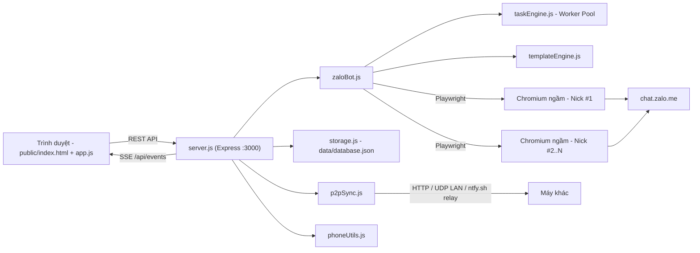
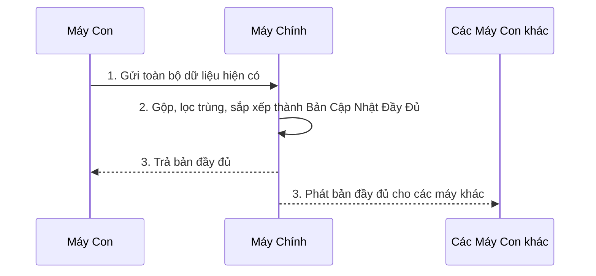

# ToolGuiZalo Pro – Web App Tự Động Gửi Tin Nhắn Zalo Đa Tài Khoản

Ứng dụng Web chạy **local** (Node.js + Express) kết hợp trình duyệt tự động **Playwright (Chromium chạy ngầm)** để:

- Tự động **tìm kiếm số điện thoại** trên Zalo Web (`chat.zalo.me`) và **gửi tin nhắn cá nhân hóa** (kèm ảnh) theo danh sách.
- **Chạy nhiều tài khoản Zalo cùng lúc** (luân phiên hoặc song song đa luồng) để gửi hàng nghìn SĐT nhanh hơn.
- **Tự phân loại kết quả** (Thành công / Chặn người lạ / Chưa đăng ký Zalo / Sai số / Lỗi) và **xuất báo cáo Excel**.
- **Theo dõi khách hàng phản hồi theo thời gian thực**, thông báo góc màn hình và mở chat trả lời ngay.
- **Đồng bộ dữ liệu giữa nhiều máy** (cùng hoặc khác mạng Wi-Fi) qua một **Máy Chính (Trạm Trung Chuyển)**.
- **Đóng gói thành 1 file `.exe` duy nhất** để gửi cho máy khác dùng ngay, không cần cài đặt.

---

## Mục lục

1. [Tính năng chi tiết](#1-tính-năng-chi-tiết)
2. [Cấu trúc mã nguồn](#2-cấu-trúc-mã-nguồn)
3. [Kiến trúc hệ thống](#3-kiến-trúc-hệ-thống)
4. [Cài đặt & chạy](#4-cài-đặt--chạy)
5. [Hướng dẫn sử dụng nhanh](#5-hướng-dẫn-sử-dụng-nhanh)
6. [Định dạng file Excel nhập](#6-định-dạng-file-excel-nhập)
7. [Biến & Spintax trong mẫu tin nhắn](#7-biến--spintax-trong-mẫu-tin-nhắn)
8. [Đồng bộ đa máy (Máy Chính & Máy Con)](#8-đồng-bộ-đa-máy-máy-chính--máy-con)
9. [Đóng gói 1 file & gửi cho máy khác](#9-đóng-gói-1-file--gửi-cho-máy-khác)
10. [Danh sách API](#10-danh-sách-api)
11. [Dữ liệu lưu trữ](#11-dữ-liệu-lưu-trữ)
12. [Lưu ý an toàn tài khoản & xử lý sự cố](#12-lưu-ý-an-toàn-tài-khoản--xử-lý-sự-cố)

---

## 1. Tính năng chi tiết

Giao diện gồm thanh menu bên trái với **8 mục**, mỗi mục có badge đếm số liệu cập nhật realtime (SSE, không cần F5).

### 📊 Tổng quan (Overview)
- Thẻ thống kê: **Tổng SĐT, Thành công, Chặn người lạ, Chưa ĐK Zalo, Đang chờ** – bấm vào thẻ để nhảy sang bảng đã lọc sẵn.
- Biểu đồ tròn (Chart.js) tỷ lệ kết quả, nhật ký hoạt động (log) realtime.
- Banner trạng thái chiến dịch (`SẴN SÀNG`, `ĐANG GỬI HÀNG LOẠT`, `ĐANG HẸN GIỜ`, `ĐANG TẠM DỪNG`) và đồng hồ đếm ngược nghỉ giãn cách / hẹn giờ.

### 1. 👤 Tài khoản Zalo (Đa tài khoản)
- Thêm / xóa / chọn nhiều tài khoản Zalo; mỗi tài khoản có **thư mục phiên riêng** trong `user_data/` → chỉ cần quét QR **1 lần**.
- **📱 Quét QR / Xem ngầm**: popup xem màn hình Zalo Web chạy ngầm (live screenshot ~2.6 FPS), có thể **click trực tiếp vào ảnh** để thao tác, nút **Tải lại / Lấy QR mới**.
- **⚡ Bật tất cả nick**: khởi động đồng loạt mọi phiên; tự **khôi phục phiên đã lưu** khi mở lại tool.
- Hiển thị tên hồ sơ Zalo, trạng thái đăng nhập, số tin đã gửi của từng nick.

### 2. ⏰ Lịch hẹn & khung giờ
- **Hẹn giờ bắt đầu** gửi (chọn nhanh +5p / +15p / +30p / +60p hoặc chọn ngày giờ cụ thể).
- **Khung giờ hoạt động** (vd: 08:00–21:30): ngoài khung giờ tool tự chờ, vào giờ tự gửi tiếp.

### 3. 📥 Nạp danh sách SĐT
- **Dán nhanh** theo dòng: `SĐT | Tên | Thông tin` hoặc **upload Excel/CSV** (`.xlsx`, `.xls`, `.csv`), tải **file Excel mẫu**.
- Tự **chuẩn hóa SĐT Việt Nam** (`+84…`, `84…`, mất số `0` đầu do Excel → `0xxxxxxxxx`), kiểm tra đầu số nhà mạng, đánh dấu `SAI_SO`.
- Tùy chọn **lọc trùng** và **thay thế toàn bộ danh sách**; nạp lại SĐT đã gửi sẽ tự đặt về `Chờ xử lý` để gửi lượt mới.

### 4. ✉️ Mẫu tin nhắn, ảnh đính kèm & tốc độ
- Soạn mẫu tin nhắn có **biến cá nhân hóa** và **Spintax**, chèn biến bằng nút, **xem trước** nội dung thực tế.
- Ưu tiên cột **Nội dung riêng** của từng SĐT (nếu có).
- **Đính kèm nhiều ảnh** (upload, dán `Ctrl+V` vào ô soạn tin) – ảnh được dán vào khung chat trước khi gửi chữ.
- **Preset tốc độ** dạng nút 3 cột:
  | Preset | Delay mỗi tin | Nghỉ theo chặng | Gợi ý |
  |---|---|---|---|
  | ⚡ Siêu Tốc | 0 – 1s | Không nghỉ | Gửi 5.000 SĐT, tự bật **Song song** khi có ≥ 2 nick |
  | 🚀 Nhanh | 2 – 4s | 15s sau mỗi 30 SĐT | Cân bằng tốc độ & an toàn |
  | 🛡️ An Toàn | 12 – 25s | 120s sau mỗi 15 SĐT | Nick mới |
- Tùy chỉnh thủ công: Min/Max delay, kích thước chặng, thời gian nghỉ chặng, chế độ dán nhanh (Fast Paste), dùng Cache SĐT, tự **Kết bạn** khi bị chặn người lạ.
- **Chế độ điều phối gửi**:
  - 🔄 **Luân phiên (Round Robin)** – mỗi nick gửi N số (mặc định 15) rồi chuyển sang nick kế tiếp.
  - ⚡ **Song song đa luồng (Parallel)** – mọi nick cùng bốc việc từ hàng đợi và gửi đồng thời.
  - 1 tài khoản (Single).

### 5. 📋 Bảng danh sách & kết quả
- Bảng có **phân trang** (15 / 25 / 50 / Tất cả), tìm kiếm, tab lọc theo trạng thái kèm số đếm.
- Cột: SĐT, Tên, Tên Zalo tìm thấy, Nick đã gửi, Trạng thái, Chi tiết lý do.
- Thao tác hàng loạt: xóa đã chọn, đặt lại trạng thái, xóa toàn bộ, xóa Cache.
- Nút **Xuất Báo Cáo (.xlsx)** trên thanh trên cùng xuất file Excel gồm 5 sheet: `1_Tong_Hop`, `2_Bi_Chan_Nguoi_La`, `3_Chua_Dang_Ky_Zalo`, `4_Gui_Thanh_Cong`, `5_Sai_So_Hoac_Loi`.

Các trạng thái phân loại:

| Mã | Ý nghĩa |
|---|---|
| `THANH_CONG` | Đã gửi tin nhắn thành công |
| `CHAN_NGUOI_LA` | Người nhận chặn tin nhắn từ người lạ |
| `KHONG_DANG_KY` | SĐT chưa đăng ký Zalo / chặn tìm kiếm bằng SĐT |
| `SAI_SO` | Sai định dạng SĐT |
| `LOI` | Lỗi thao tác khác |
| `PENDING` / `PROCESSING` | Chờ xử lý / Đang tìm & gửi |

### 6. 💬 Khách đã phản hồi (Realtime)
- Bộ quét ngầm kiểm tra danh sách hội thoại của **tất cả nick đang đăng nhập** mỗi **1.5 giây**, giao diện đồng bộ thêm mỗi 2.5 giây.
- **Phản hồi mới nhất luôn nằm trên đầu** (sắp xếp theo thời gian phản hồi), dòng mới có nhãn `MỚI`.
- Tự **ghép khách theo tên Zalo** với SĐT đã gửi; khách nhắn trực tiếp trên Zalo Web được thêm với nhãn `Từ Zalo Web`, tự gộp nếu trùng tên với SĐT thật.
- **Thông báo nhỏ góc dưới bên phải** (hiện 2s, có âm báo) trên **mọi trang**: *“Tên khách phản hồi tại Tài khoản Zalo #x”*. Mỗi phản hồi chỉ báo **1 lần**, chỉ báo lại khi có tin mới sau khi đã xem.
- Lọc theo nick nhận tin, tìm kiếm, nút **Mở chat** (mở đúng nick & hội thoại trong popup xem ngầm), **Xuất Excel phản hồi**, **Đặt lại**.

### 7. 🌐 Đồng bộ đa máy
- Máy Chính (Trạm Trung Chuyển) + các Máy Con, liên kết bằng IP, hoạt động cả **khác mạng Wi-Fi**. Chi tiết ở [mục 8](#8-đồng-bộ-đa-máy-máy-chính--máy-con).

### 🛡️ Cơ chế bảo vệ tài khoản
- Nghỉ ngẫu nhiên giữa các SĐT + nghỉ theo chặng.
- **Cache SĐT**: số đã xác định *Chưa đăng ký Zalo* sẽ không tốn lượt tìm kiếm lần sau.
- Tự **dừng nick** khi Zalo báo *“tìm kiếm quá nhiều lần / hoạt động bất thường”*, trả SĐT về hàng chờ để nick khác gửi tiếp.
- Tự giải phóng SĐT kẹt ở trạng thái `PROCESSING` khi dừng hoặc khởi động lại.

---

## 2. Cấu trúc mã nguồn

```text
ToolGuiZalo/
├── server.js               # Express server: REST API, SSE realtime, nhập/xuất Excel, khởi động P2P Sync
├── package.json            # Khai báo dependencies (express, cors, multer, playwright, xlsx)
├── start.bat               # Launcher Windows: tìm node.exe portable → npm install (nếu thiếu) → chạy server
├── build_exe.bat           # Đóng gói thành ToolGuiZalo_Setup.exe (WinRAR SFX) + ToolGuiZalo_Portable.rar
├── sfx_config.txt          # Kịch bản SFX: bung ngầm vào C:\ToolGuiZalo, tạo shortcut Desktop, chạy start.bat
├── node.exe                # Node.js portable (chạy không cần cài Node)
│
├── src/
│   ├── zaloBot.js          # Lõi tự động hóa Playwright: đa phiên, gửi tin, phân loại, quét phản hồi, chiến dịch
│   ├── storage.js          # Lưu trữ JSON (data/database.json): contacts, accounts, settings, cache, logs, merge/dedupe
│   ├── taskEngine.js       # Task Orchestrator: hàng đợi, Worker Pool, claim/complete/fail/reclaim task
│   ├── p2pSync.js          # Đồng bộ đa máy: Master/Client, UDP LAN discovery, HTTP trực tiếp, relay ntfy.sh (gzip)
│   ├── templateEngine.js   # Render tin nhắn: biến {ten}/{sdt}/…, cột Excel mở rộng, Spintax {a|b|c}
│   └── phoneUtils.js       # Chuẩn hóa & kiểm tra SĐT Việt Nam
│
├── public/                 # Giao diện Web (Bootstrap 5 + Bootstrap Icons + Chart.js)
│   ├── index.html          # Layout sidebar + 8 panel + popup QR/xem ngầm
│   ├── app.js              # Logic frontend: state, render bảng, SSE, toast phản hồi, preset tốc độ, đồng bộ
│   └── styles.css          # Giao diện tùy biến (segmented control tốc độ, badge, panel…)
│
├── data/
│   ├── database.json       # Cơ sở dữ liệu cục bộ (tự tạo)
│   └── hub_config.json     # Cấu hình Máy Chính: hostname, IP public, IP LAN, port, role
│
├── uploads/images/         # Ảnh đính kèm tin nhắn
├── user_data/              # Phiên đăng nhập Chromium của từng nick Zalo (không đóng gói)
└── .github/workflows/      # CI mẫu (Azure Web Apps, npm publish)
```

### Vai trò các module chính

| Module | Thành phần quan trọng |
|---|---|
| `src/zaloBot.js` | `launchBrowser`, `launchAllAccounts`, `autoRestoreSavedSessions`, `ensureAccountReady`, `getLiveScreenshot`, `clickOnPage`, `startCampaign`, `runSequentialCampaign` (luân phiên), `runParallelCampaign` (song song), `runWorker`, `processContactOnPage`, `pollPhoneLookupResult`, `pasteImagesIntoChat`, `typeMultilineFast`, `recordResult`, `checkReplies`, `markRepliesSeen`, `openChat`, `startScheduleWatcher`, `isWithinActiveHours` |
| `src/storage.js` | `getContacts`, `appendContacts`, `addContact`, `updateContact`, `deduplicateContacts`, `getRepliedContactsSorted`, `mergeRemoteData`, `sortAndConsolidateContacts`, `prepareContactsForCampaign`, `releaseStuckContacts`, quản lý accounts / settings / phoneCache / logs |
| `src/taskEngine.js` | `initQueue`, `registerWorkers`, `claimTask`, `completeTask`, `failTask`, `reclaimWorkerTasks`, `setWorkerCountdown`, `pause/resume`, `getSummary` |
| `src/p2pSync.js` | `isMasterHub`, `setMasterHubConfig`, `detectLocalIp`, `detectPublicIp`, `initUdpDiscovery` (UDP `38999`), `listenNtfyStream`, `publishRelayPacket`, `handleDirectClientExchange`, `syncAll` |
| `src/templateEngine.js` | `processSpintax`, `renderMessage` |
| `src/phoneUtils.js` | `normalizePhone` |

---

## 3. Kiến trúc hệ thống



Luồng gửi 1 SĐT (`processContactOnPage`): mở hộp thoại **Thêm bạn** → nhập SĐT → **Tìm kiếm** → đọc kết quả (có hồ sơ / chưa đăng ký / bị giới hạn) → bấm **Nhắn tin** → kiểm tra khung chat bị khóa → dán ảnh + nhập nội dung (giữ xuống dòng) → `Enter` → kiểm tra thông báo chặn người lạ → ghi kết quả.

---

## 4. Cài đặt & chạy

### Cách 1 – Dùng file đóng gói (khuyên dùng cho người dùng cuối)
1. Nhận file `ToolGuiZalo_Portable.rar` (bên trong chỉ có `ToolGuiZalo_Setup.exe`) hoặc trực tiếp `ToolGuiZalo_Setup.exe`.
2. Giải nén (nếu là `.rar`) và **nháy đúp `ToolGuiZalo_Setup.exe`** → tool tự bung vào `C:\ToolGuiZalo`, tạo shortcut Desktop và mở trình duyệt tại **http://localhost:3000**.

### Cách 2 – Chạy từ mã nguồn
Yêu cầu: Windows, Node.js ≥ 18 (hoặc dùng `node.exe` portable đi kèm).

```bash
npm install
npx playwright install chromium   # lần đầu, nếu máy chưa có Chromium của Playwright
npm start
```

Hoặc **nháy đúp `start.bat`** (tự tìm `node.exe`, tự `npm install` nếu thiếu `node_modules`). Trình duyệt tự mở tại 👉 **http://localhost:3000**.

Biến môi trường:

| Biến | Ý nghĩa |
|---|---|
| `PORT` | Cổng server (mặc định `3000`, nếu bận tự thử cổng kế tiếp) |
| `NO_AUTO_OPEN=true` | Không tự mở trình duyệt khi khởi động |

> Giữ nguyên cửa sổ console trong suốt quá trình dùng tool – đóng cửa sổ sẽ dừng server.

---

## 5. Hướng dẫn sử dụng nhanh

1. **Mục 1 – Tài khoản Zalo**: thêm nick → bấm **📱 Quét QR / Xem ngầm** → quét QR bằng app Zalo trên điện thoại.
2. **Mục 3 – Nạp SĐT**: dán danh sách hoặc upload Excel.
3. **Mục 4 – Mẫu tin nhắn**: soạn nội dung, đính kèm ảnh, chọn preset tốc độ và chế độ gửi (Luân phiên / Song song) → **Lưu cấu hình**.
4. (Tùy chọn) **Mục 2 – Lịch hẹn**: đặt giờ bắt đầu / khung giờ hoạt động.
5. Bấm **▶ Bắt đầu gửi** trên thanh trên cùng; theo dõi tiến độ ở **Tổng quan** và **Mục 5 – Bảng danh sách**.
6. Xem khách nhắn lại ở **Mục 6 – Khách đã phản hồi**, bấm **Mở chat** để trả lời.
7. Bấm **Xuất Báo Cáo (.xlsx)** trên thanh trên cùng hoặc **Xuất Excel Phản Hồi** ở Mục 6.

---

## 6. Định dạng file Excel nhập

Tool tự nhận diện cột theo tên (không phân biệt hoa/thường, có dấu/không dấu); nếu không khớp sẽ lấy theo thứ tự cột 1→5.

| Trường | Tên cột được nhận diện |
|---|---|
| SĐT *(bắt buộc)* | `SDT`, `So dien thoai`, `Dien thoai`, `Phone`, `Mobile`, `Tel`, `Zalo` |
| Tên | `Ten`, `Ho ten`, `Khach hang`, `Name`, `Fullname`, `Nguoi nhan` |
| Thông tin | `Thong tin`, `Info`, `Ma don`, `Don hang`, `San pham`, `Dich vu`, `Du lieu` |
| Nội dung riêng | `Noi dung`, `Tin nhan`, `Message`, `Content`, `Loi nhan` |
| Ghi chú | `Ghi chu`, `Note`, `Nhan xet` |

Mọi cột khác trong file đều dùng được làm biến trong mẫu tin nhắn. Tải file mẫu bằng nút **Tải file mẫu Excel** ở Mục 3 (`/api/contacts/sample-excel`).

Định dạng dán nhanh (mỗi dòng 1 khách):
```text
0912345678 | Nguyễn Văn An | Đơn hàng #DH101 - Giao ngày 15/11
+84938112235 | Phạm Minh Tuấn | Lịch hẹn bảo dưỡng xe 09h30
```

---

## 7. Biến & Spintax trong mẫu tin nhắn

| Biến | Giá trị |
|---|---|
| `{ten}`, `{name}`, `{hoten}`, `{ho_ten}` | Tên khách (mặc định `Anh/Chị`) |
| `{sdt}`, `{phone}` | Số điện thoại |
| `{thong_tin}`, `{thongtin}`, `{info}` | Cột thông tin |
| `{ghi_chu}`, `{ghichu}`, `{note}` | Cột ghi chú |
| `{noi_dung}`, `{noidung}` | Cột nội dung riêng |
| `{Ten_Cot_Bat_Ky}` | Giá trị của cột bất kỳ trong file Excel |

**Spintax** `{lựa chọn 1|lựa chọn 2|…}` – mỗi tin chọn ngẫu nhiên 1 cụm để nội dung tự nhiên, giảm rủi ro bị đánh dấu spam:

```text
{Xin chào|Chào|Em chào} {ten},
Mình gửi bạn thông tin: {thong_tin}
Nếu cần hỗ trợ thêm bạn cứ phản hồi lại tin nhắn này nhé!
```

---

## 8. Đồng bộ đa máy (Máy Chính & Máy Con)

- **Máy Chính (`MASTER`)** – Trạm Trung Chuyển, cấu hình trong `data/hub_config.json` (`masterHostname`, `masterIp`, `masterLanIp`, `masterPort`). File cấu hình này được đóng gói kèm `.exe`, nên máy nhận file sẽ tự chạy ở vai trò **Máy Con (`CLIENT`)** đã liên kết sẵn với Máy Chính.
- Có thể đổi vai trò / nhập IP Máy Chính thủ công tại **Mục 7**.
- Các máy **làm việc độc lập**; chỉ đồng bộ khi bấm **⚡ Đồng Bộ Ngay**:



- Quy tắc gộp: ưu tiên trạng thái đã xử lý (`THANH_CONG`, `CHAN_NGUOI_LA`, `KHONG_DANG_KY`) hơn `PENDING`, gộp kết quả theo từng nick, giữ phản hồi mới nhất theo thời gian.
- Kênh truyền tự động:
  1. **HTTP trực tiếp** `POST /api/sync/hub-exchange` (cùng LAN / VPN / đã mở port).
  2. **Relay HTTPS qua `ntfy.sh`** (nén gzip, hỗ trợ dữ liệu lớn qua file đính kèm) khi khác mạng Wi-Fi, **không cần mở port router**.
  3. **UDP broadcast** cổng `38999` để tự phát hiện máy trong cùng mạng LAN.

---

## 9. Đóng gói 1 file & gửi cho máy khác

Yêu cầu WinRAR tại `C:\Program Files\WinRAR\Rar.exe`, sau đó chạy:

```bat
build_exe.bat
```

Kết quả:

| File | Mục đích |
|---|---|
| `ToolGuiZalo_Setup.exe` | 1 file duy nhất (WinRAR SFX) chứa `node.exe`, `server.js`, `src`, `public`, `data`, `node_modules`… Nháy đúp là chạy |
| `ToolGuiZalo_Portable.rar` | Bên trong **chỉ có `ToolGuiZalo_Setup.exe`** – dùng để gửi qua Zalo (Zalo chặn gửi trực tiếp file `.exe`) |

Không đóng gói: `user_data/` (phiên đăng nhập), `.agents/`, `graphify-out/`, `bin/`, `.git/`, `dist/`.

---

## 10. Danh sách API

Realtime: `GET /api/events` (SSE) phát các sự kiện `status`, `contact_updated`, `contacts_replaced`, `log`, `reply_received`, `replies_updated`, `sync_status`, `peer_connected`.

| Nhóm | Endpoint |
|---|---|
| Trạng thái & cấu hình | `GET /api/state` · `POST /api/settings` · `POST /api/preview-message` |
| Ảnh đính kèm | `POST /api/images/upload` · `DELETE /api/images/:id` · `DELETE /api/images` |
| Tài khoản Zalo | `POST /api/accounts` · `POST /api/accounts/switch` · `POST /api/accounts/launch-all` · `DELETE /api/accounts/:id` |
| Danh bạ | `POST /api/contacts/import-text` · `POST /api/contacts/import-file` · `GET /api/contacts/sample-excel` · `POST /api/contacts/reset` · `DELETE /api/contacts` · `DELETE /api/contacts/:id` · `DELETE /api/cache` |
| Báo cáo | `GET /api/reports/export-excel` · `GET /api/reports/export-replies-excel` |
| Trình duyệt ngầm | `POST /api/browser/open` · `GET /api/browser/screenshot` · `POST /api/browser/click` · `POST /api/browser/reload` · `POST /api/browser/close` · `POST /api/browser/open-chat` |
| Chiến dịch | `POST /api/campaign/start` · `POST /api/campaign/pause` · `GET /api/orchestrator/status` · `POST /api/orchestrator/mode` |
| Phản hồi khách | `GET /api/replies` · `POST /api/replies/check` · `POST /api/replies/seen` · `POST /api/replies/reset` · `POST /api/contacts/:id/reply` |
| Đồng bộ đa máy | `GET /api/sync/info` · `GET /api/sync/state` · `POST /api/sync/merge` · `POST /api/sync/hub-exchange` · `POST /api/sync/config` · `POST /api/sync/trigger` · `POST /api/sync/add-peer` |

---

## 11. Dữ liệu lưu trữ

| Đường dẫn | Nội dung |
|---|---|
| `data/database.json` | `settings`, `accounts`, `activeAccountId`, `contacts` (kết quả theo từng nick, thông tin phản hồi), `phoneCache`, `logs` (300 dòng gần nhất) |
| `data/hub_config.json` | Cấu hình Máy Chính / vai trò đồng bộ |
| `uploads/images/` | Ảnh đính kèm tin nhắn |
| `user_data/zalo_profile*` | Phiên đăng nhập Chromium của từng nick Zalo |

> `data/`, `uploads/`, `user_data/` đã nằm trong `.gitignore` – **không commit** lên Git vì chứa dữ liệu khách hàng và phiên đăng nhập.

---

## 12. Lưu ý an toàn tài khoản & xử lý sự cố

- Zalo giới hạn số lần **tìm kiếm SĐT** mỗi ngày cho mỗi nick; nick mới nên dùng preset **🛡️ An Toàn**. Tăng tốc bằng cách thêm nhiều nick và dùng chế độ **Song song**, không nên chỉ giảm delay.
- Khi một nick bị Zalo giới hạn, tool tự dừng nick đó và chuyển SĐT cho nick khác.
- Tuân thủ điều khoản sử dụng của Zalo và quy định về tin nhắn quảng cáo; chỉ gửi cho khách hàng đã đồng ý nhận tin.

| Sự cố | Cách xử lý |
|---|---|
| Trang báo không kết nối | Kiểm tra cửa sổ console còn mở; chạy lại `start.bat` |
| Cổng 3000 bị chiếm | Tool tự chuyển sang cổng 3001, 3002… (xem console) hoặc đặt biến `PORT` |
| Không hiện QR / màn hình trắng | Bấm **Tải lại / Lấy QR mới** trong popup xem ngầm |
| Báo thiếu Chromium | Chạy `npx playwright install chromium` |
| Máy Con không đồng bộ được | Kiểm tra Máy Chính đang mở tool, IP Máy Chính đúng ở Mục 7, máy có Internet (relay `ntfy.sh` qua HTTPS 443) |
| Không gửi được file `.exe` qua Zalo | Gửi file `ToolGuiZalo_Portable.rar` thay thế |
