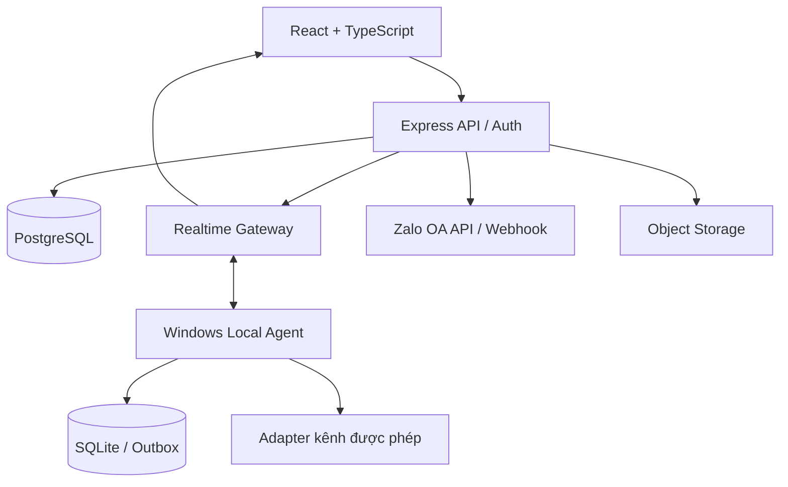

# TOOLGUIZALO PRO V2
## Kế hoạch tối ưu và phát triển toàn diện

**Cơ sở phân tích:** README(1).md, mục 1–12. Đây là đề xuất kiến trúc, chưa phải kết quả kiểm thử source code. Các mục tiêu hiệu năng dưới đây là tiêu chí nghiệm thu đề xuất, không phải số đo thực tế.

## 1. Định hướng sản phẩm
Phát triển từ công cụ local thành nền tảng quản lý khách hàng và tác vụ đa thiết bị. Giữ Express, các module chuẩn hóa số điện thoại, mẫu nội dung và những chức năng đã được kiểm chứng. Ưu tiên API Zalo chính thức cho nghiệp vụ được hỗ trợ; chỉ liên hệ người đã đồng ý nhận tin. Không chuyển tài khoản để vượt giới hạn nền tảng, không tự kết bạn khi bị chặn, loại bỏ preset gửi siêu tốc và cơ chế biến đổi nội dung nhằm né phát hiện spam.

## 2. Đánh giá và ưu tiên
| Hiện trạng theo README | Rủi ro cần kiểm chứng | Đề xuất | Ưu tiên |
|---|---|---|---|
| database.json | Ghi đồng thời, mất dữ liệu | SQLite WAL, transaction, backup | P0 |
| zaloBot.js chứa nhiều trách nhiệm | Khó bảo trì, lỗi lan truyền | Tách quản lý phiên, adapter và giám sát | P0 |
| SSE + polling 1,5/2,5 giây | Tải dư thừa, render lặp | Event-driven, cập nhật từng bản ghi | P1 |
| Screenshot khoảng 2,6 FPS | CPU/RAM và băng thông | Chỉ chụp khi mở popup, dừng khi đóng | P1 |
| Worker Pool | Trạng thái tác vụ chưa chắc bền vững | Persistent queue, chống trùng | P0 |
| Đồng bộ toàn bộ dữ liệu thủ công | Xung đột, lộ dữ liệu | Delta sync qua server xác thực | P0 |
| Ghép khách theo tên Zalo | Nhầm người trùng tên | ID hội thoại ổn định, xác minh thủ công | P0 |
| Bootstrap + app.js | Khó mở rộng | Module hóa rồi chuyển React từng phần | P2 |
| WinRAR SFX | Khó cập nhật, nguy cơ đóng gói dữ liệu | Inno Setup, bản phát hành ký số | P2 |

## 3. Kiến trúc đích

Giai đoạn local: Express + SQLite + SSE, không cần cloud hoặc Redis. Giai đoạn đa máy: PostgreSQL là nguồn dữ liệu chuẩn; agent kết nối ra ngoài bằng HTTPS/WSS, giữ phiên local, không mở cổng trực tiếp ra Internet. Redis chỉ bổ sung khi đo được nhu cầu. Dùng modular monolith trước, chưa cần microservices.

## 4. Lưu trữ và migration
- SQLite WAL, foreign keys, busy timeout, transaction ngắn; dùng Drizzle hoặc lớp repository thống nhất. PostgreSQL khi triển khai trung tâm.
- Bảng: users, roles, devices, accounts, contacts, contact_consents, contact_tags, campaigns, campaign_contacts, tasks, task_attempts, conversations, messages, templates, attachments, notifications, audit_logs, sync_events, outbox, settings.
- UUID, created_at, updated_at, version; index theo trạng thái, thời gian, campaign_id và conversation_id. Số điện thoại chuẩn hóa dạng chuỗi; không dùng tên hiển thị làm khóa định danh.
- Unique constraint theo phạm vi nghiệp vụ; lưu lịch sử chiến dịch riêng, không reset lịch sử khi nhập lại danh sách.
- Migration: sao lưu JSON và ảnh; kiểm tra schema; nhập trong transaction; đối chiếu số lượng, trạng thái và liên kết; chạy thử trên bản sao; chỉ chuyển nguồn đọc/ghi sau nghiệm thu. Giữ bản cũ để rollback có kiểm soát.
- Backup mã hóa hằng ngày, lưu ngoài máy chủ, chính sách giữ 7 bản ngày/4 bản tuần (đề xuất), thử phục hồi định kỳ. Mục tiêu RPO 24h, RTO 2h ban đầu.

## 5. Backend và API
Tách route/controller/service/repository; dùng Zod kiểm tra input, Pino log có che thông tin cá nhân, middleware xác thực, error handler chung. API version /api/v2; phân trang cursor hoặc limit có giới hạn; truy vấn lọc phía server. Tách tác vụ dài khỏi request HTTP. Trả mã lỗi có cấu trúc và correlation ID.

Nhóm API đề xuất: /auth, /contacts, /consents, /campaigns, /tasks, /conversations, /templates, /devices, /events, /health, /reports, /backups. Giữ adapter tương thích API V1 trong thời gian chuyển đổi. Kiểm tra quyền ở từng endpoint, không chỉ ở giao diện.

## 6. Realtime và hiệu năng frontend
Giữ SSE nếu chỉ cần server đẩy sự kiện; dùng Socket.IO cho kết nối hai chiều của agent khi cần. Không bắt buộc thay SSE bằng WebSocket. Sự kiện: contact.updated, task.updated, conversation.updated, device.status, sync.completed, system.health. Mỗi sự kiện có eventId, entityId, version, timestamp; reconnect lấy snapshot hoặc replay từ cursor. Dedupe và bỏ sự kiện cũ. Không gửi toàn bộ danh sách khi chỉ một dòng thay đổi. Webhook chính thức cho phản hồi nếu kênh hỗ trợ; không cam kết realtime tuyệt đối từ Zalo Web.

React + Vite + TypeScript, TanStack Query/Table, Zustand cho UI state nhỏ, Tailwind/shadcn tùy nhu cầu. Phân trang server, virtual list cho bảng lớn, debounce tìm kiếm, lazy load màn hình, cập nhật chart theo batch. Không render toàn bộ dashboard khi có log mới. Đo bằng browser performance profiler trước/sau.

## 7. Local Agent và chạy nền Windows
Tách Express khỏi tiến trình quản lý trình duyệt để lỗi không làm sập giao diện. Agent có tray icon, trạng thái online/offline, health check, graceful shutdown, khởi động lại có kiểm soát. Dùng Task Scheduler hoặc tray app theo phiên Windows; Windows Service chỉ cho thành phần không cần desktop tương tác. Không lưu QR, cookie hay profile vào cloud; bảo vệ thư mục bằng ACL Windows. Chỉ chụp màn hình khi người dùng yêu cầu, dừng timer/listener khi đóng popup. Theo dõi CPU, RAM, event loop lag, số tiến trình và lỗi; đo rò rỉ tài nguyên qua kiểm thử dài hạn. Ưu tiên chuyển nghiệp vụ gửi/nhận sang API chính thức; không tối ưu tự động hóa nhằm vượt giới hạn gửi hoặc tìm kiếm.

## 8. Task Engine và độ tin cậy
Trạng thái: PENDING → ASSIGNED → PROCESSING → COMPLETED / FAILED / REVIEW / CANCELLED. Lưu tác vụ bền vững, transaction khi nhận việc, khóa có thời hạn, heartbeat, timeout và audit. Chỉ retry lỗi nội bộ an toàn; thao tác bên ngoài có kết quả không rõ phải chuyển REVIEW, không tự gửi lại. Idempotency key cho thao tác có hỗ trợ. Dừng chiến dịch khi hết quyền đồng ý hoặc nền tảng báo giới hạn; không chuyển việc sang tài khoản khác để né giới hạn. Lịch dùng timezone rõ ràng, xử lý restart và lịch quá hạn theo chính sách người dùng.

## 9. Đồng bộ đa máy
Thay full snapshot qua ntfy.sh bằng delta sync xác thực qua HTTPS/WSS. Outbox lưu thay đổi chưa gửi; server cấp cursor và version; ack sau commit; xử lý bản ghi xóa bằng tombstone. Server là nguồn chuẩn; xung đột thông tin khách hàng đưa vào màn hình review nếu không thể hợp nhất an toàn. Offline chỉ cho phép xem/chỉnh dữ liệu được phép; không tự thực thi thao tác gửi khi chưa xác minh quyền và trạng thái mới nhất. Ghép thiết bị bằng mã dùng một lần, token có thể thu hồi. Không chuyển phiên đăng nhập hoặc dữ liệu khách hàng qua relay công cộng.

## 10. Bảo mật và quyền riêng tư
- Local bind 127.0.0.1 mặc định; kiểm tra Origin/CSRF, CORS allowlist, giới hạn request, xác thực cả API screenshot/click/sync.
- Cloud HTTPS, RBAC Admin/Operator/Viewer, mật khẩu Argon2id nếu tự quản lý, MFA cho quản trị, token ngắn hạn và thu hồi thiết bị.
- Mã hóa backup, secret lưu ngoài Git, che số điện thoại và nội dung trong log; không ghi token, QR, cookie.
- Upload kiểm tra MIME thực tế, kích thước, tên file, đường dẫn; xuất Excel chống formula injection; giới hạn dung lượng import.
- Ghi nhận nguồn, thời điểm, phạm vi đồng ý nhận tin; danh sách từ chối nhận tin có hiệu lực toàn hệ thống. Có chức năng xóa/xuất dữ liệu và chính sách lưu giữ phù hợp quy định.
- Kiểm tra dependency, secret scanning, phân quyền tối thiểu; rà soát điều khoản Zalo trước triển khai.

## 11. Giao diện và chức năng
| Màn hình | Nâng cấp |
|---|---|
| Overview | KPI, tiến độ, lỗi, trạng thái thiết bị, bộ lọc thời gian |
| Accounts | Trạng thái phiên, cảnh báo, đăng xuất/thu hồi |
| Contacts | Tag, nhóm, lịch sử, consent, nhập Excel có preview và mapping |
| Campaigns | Bản nháp, phê duyệt, lịch, lịch sử độc lập, dừng/hủy |
| Inbox | Hội thoại theo ID, chưa đọc, phân công, ghi chú, trả lời qua kênh được phép |
| Templates | Phiên bản, preview, kiểm tra biến thiếu, phê duyệt |
| Devices | Online/offline, phiên bản, kết nối, thu hồi |
| Task Manager | Trạng thái, lỗi, review, lịch sử |
| Analytics | Tỷ lệ phản hồi, chất lượng dữ liệu, báo cáo theo thời gian |
| System Monitor | CPU, RAM, disk, event loop, health |
| Security/Audit | Quyền, nhật ký, cảnh báo |
| Backup Center | Sao lưu, kiểm tra và phục hồi |
| Settings | Timezone, thông báo, theme, retention |
Dark/light mode, responsive, tìm kiếm, trạng thái loading/empty/error, xác nhận thao tác xóa, thông báo không trùng. AI gợi ý trả lời và tóm tắt chỉ khi có quyền xử lý dữ liệu, người dùng duyệt trước khi gửi. Workflow Builder dành cho nhắc lịch/chăm sóc đã được đồng ý; triển khai sau khi lõi ổn định.

## 12. Cấu trúc mã nguồn đích
```text
apps/
  web/src/{features,components,hooks,services,stores}
  server/src/{routes,modules,middleware,repositories,realtime}
  agent/src/{sessions,adapters,storage,monitoring}
packages/{shared-types,validation,database,event-protocol}
tests/{unit,integration,e2e,performance}
scripts/{migration,backup,restore}
docs/
.github/workflows/
.env.example
```
Tách storage.js trước bằng repository, sau đó tách server.js và zaloBot.js theo trách nhiệm. Giữ phoneUtils.js và templateEngine.js sau khi bổ sung unit test. Thay p2pSync.js theo giai đoạn, không duy trì hai nguồn dữ liệu chuẩn đồng thời.

## 13. Deploy và lưu dữ liệu lâu dài
GitHub quản lý source, GitHub Actions chạy lint/test/build. Frontend static hosting hoặc cùng VPS; backend Node.js trên VPS/container; PostgreSQL có persistent volume hoặc managed database; ảnh ở object storage; agent chạy Windows local. Không lưu dữ liệu trên filesystem tạm của hosting. Dữ liệu không được đảm bảo vĩnh viễn: cần backup độc lập, giám sát dung lượng và chi phí. Dùng môi trường dev/staging/prod riêng, migration có kiểm soát, health check, rollback tương thích schema. Node.js dùng phiên bản LTS còn được hỗ trợ. Docker cho server, không bắt buộc cho agent Windows.

## 14. Đóng gói và cập nhật
Inno Setup/NSIS thay SFX; cài runtime đã kiểm tra, dữ liệu đặt ngoài thư mục chương trình, không đóng gói database khách hàng, hub secret, ảnh, profile. Installer ký số nếu có điều kiện. GitHub Releases chứa checksum và bản phát hành; xác minh chữ ký/checksum trước update; sao lưu trước migration; không tự cập nhật giữa tác vụ đang chạy. Uninstall cho phép giữ hoặc xóa dữ liệu có xác nhận.

## 15. Kiểm thử và tiêu chí nghiệm thu
| Hạng mục | Mục tiêu đề xuất |
|---|---|
| API danh sách | p95 dưới 300 ms với 50.000 bản ghi trên máy kiểm thử đã ghi cấu hình |
| Realtime nội bộ | p95 dưới 1 giây từ commit đến UI khi mạng ổn định |
| UI | Không reload toàn trang khi cập nhật một bản ghi |
| Độ bền | Kiểm thử chạy 24 giờ, không tăng RAM không giới hạn |
| Khôi phục | Restart không mất tác vụ đã commit; kết quả không rõ đưa REVIEW |
| Đồng bộ | Không mất thay đổi đã ack; không nhân đôi khi replay |
| Bảo mật | API nhạy cảm từ chối truy cập không có quyền |
| Backup | Phục hồi thành công trên môi trường sạch |
Các ngưỡng phải hiệu chỉnh theo phần cứng và benchmark thực tế. Unit test chuẩn hóa SĐT, template, consent; integration test migration, transaction, API, sync; E2E import, lọc, quyền, reconnect, backup. Dùng mock/sandbox cho kiểm thử tải, không gửi tin thật hàng loạt. Kiểm thử mất mạng, mất điện mô phỏng, file hỏng, hết dung lượng, trùng tên, xóa thiết bị và xung đột phiên bản.

## 16. Roadmap triển khai
| Giai đoạn | Công việc | Điều kiện hoàn thành |
|---|---|---|
| 0 (tuần 1) | Audit source, đo baseline, rà soát quyền và backup | Có test và số đo ban đầu |
| 1 (tuần 2–3) | SQLite, migration, auth, consent | Đối chiếu dữ liệu, restore thành công |
| 2 (tuần 4–5) | Refactor backend, agent, task durability | Restart an toàn, log/health hoạt động |
| 3 (tuần 6–7) | Realtime, PostgreSQL, sync delta | Reconnect và conflict test đạt |
| 4 (tuần 8–9) | React UI, Inbox, CRM cơ bản | Tương thích nghiệp vụ V1 được phép |
| 5 (tuần 10–12) | Installer, CI/CD, bảo mật, pilot | Nghiệm thu và rollback thử thành công |
Lịch 12 tuần chỉ là ước tính; chưa biết quy mô đội ngũ và chất lượng code. AI, workflow nâng cao và Redis hoãn đến khi có nhu cầu thực tế.

## 17. Checklist bàn giao
- [ ] Audit server.js, storage.js, zaloBot.js, taskEngine.js, p2pSync.js, public/app.js.
- [ ] Loại bỏ cơ chế vượt giới hạn nền tảng; bổ sung consent và opt-out.
- [ ] Backup dữ liệu V1, đo baseline, viết regression test.
- [ ] SQLite + migration + repository + index.
- [ ] Auth, RBAC, bảo mật upload và phiên.
- [ ] Task bền vững, trạng thái REVIEW, graceful shutdown.
- [ ] Agent và giám sát tài nguyên.
- [ ] SSE/realtime incremental và reconnect.
- [ ] PostgreSQL + delta sync + device enrollment.
- [ ] UI module hóa, React từng màn hình.
- [ ] CRM, Inbox, báo cáo, audit, backup center.
- [ ] Installer, CI/CD, staging, kiểm thử và pilot.

## 18. Quyết định kỹ thuật chốt
Bắt đầu bằng Express + SQLite + SSE, TypeScript hóa dần; chưa cần viết lại frontend hay thuê server lớn. Khi thực sự cần đa máy, thêm PostgreSQL trung tâm và agent xác thực. Giữ kiến trúc đơn giản, đo trước khi tối ưu, không đánh đổi an toàn dữ liệu hoặc tuân thủ nền tảng lấy tốc độ. Tài liệu này là backlog và kiến trúc đề xuất; bước tiếp theo cần kiểm tra source thực tế để xác định file, hàm và thay đổi cụ thể.
