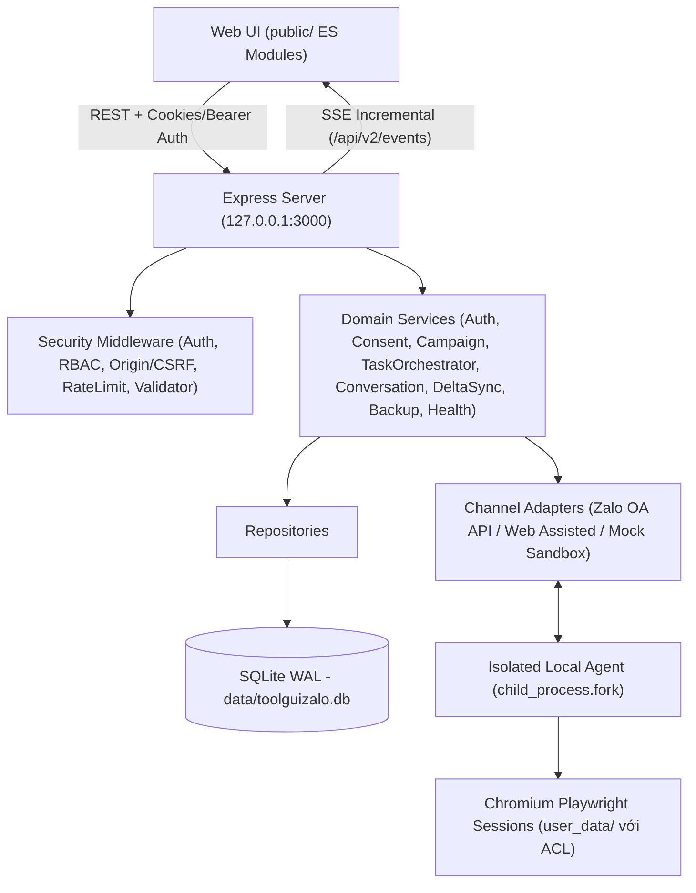

# Kiến trúc ToolGuiZalo Pro V2

Tài liệu mô tả kiến trúc thực thi V2 được triển khai theo lộ trình [ToolGuiZalo_Pro_V2_Roadmap.md](../ToolGuiZalo_Pro_V2_Roadmap.md).

## 1. Tổng quan kiến trúc Modular Monolith + Isolated Local Agent

## 2. Nguyên tắc vận hành & tuân thủ

1. **Chính sách nền tảng & Consent:**
   - Mọi liên hệ chỉ được gửi tin khi `contact_consents.status = 'OPTED_IN'`; danh sách từ chối (`OPTED_OUT`) có hiệu lực toàn hệ thống.
   - Ưu tiên `ZaloOfficialAdapter` khi cấu hình OA token; chế độ `web_assisted` tuân thủ giới hạn nền tảng, không có preset `TURBO`, không tự kết bạn khi bị chặn, không tự nhảy nick khác để vượt `RATE_LIMITED`, không spintax né spam.
2. **Độ bền dữ liệu & Tác vụ:**
   - SQLite bật `WAL`, `foreign_keys = ON`, `busy_timeout = 5000`.
   - Trạng thái tác vụ chuẩn: `PENDING → ASSIGNED → PROCESSING → COMPLETED / FAILED / REVIEW / CANCELLED`.
   - Giao dịch `BEGIN IMMEDIATE` khi Worker nhận việc; kết quả thao tác ngoài không rõ ràng chuyển sang `REVIEW` thay vì gửi trùng.
3. **Đồng bộ đa máy có xác thực (Delta Sync):**
   - Ghép thiết bị bằng mã dùng một lần (`/api/v2/devices/pair`), cấp token thu hồi được.
   - Thay đổi lưu vào bảng `outbox` và `tombstones`; client gửi và kéo delta qua `/api/v2/sync/delta` theo con trỏ `cursor` và `version`; xung đột đưa vào `sync_conflicts` để kiểm duyệt thủ công.
4. **Bảo mật & Sao lưu:**
   - Mặc định chỉ lắng nghe `127.0.0.1`; RBAC 3 vai trò (`admin`, `operator`, `viewer`), mật khẩu băm `Argon2id`, hỗ trợ TOTP MFA.
   - Upload kiểm tra magic bytes & dung lượng; xuất Excel thoát ký tự công thức; backup mã hóa `AES-256-GCM` kèm checksum `SHA-256`.
